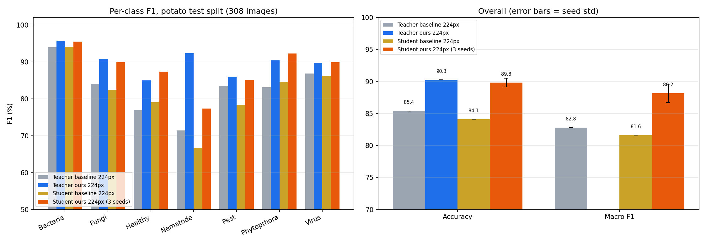

# Complete experiment record

This ledger reconciles the saved JSON metrics, training logs, and executed Kaggle notebooks found in the workspace. Percentages are reported as printed or recomputed from saved metrics. A result is called **verified** only when a metrics file or completed notebook output exists. A notebook command, expected score, or interrupted run is not treated as a result.

## How to read the comparisons

- **Fixed split** means the manifest split of 2,492 train / 276 validation / 308 test images.
- Some early Kaggle notebooks instead built 2,487 / 274 / 315 splits. Those results are recorded in a separate section and must not be ranked against the fixed-split results.
- “Raw” is single-model, single-view inference. TTA, calibration, bias tuning, and model averaging are listed separately.
- “Scratch” and “warm-start” are different protocols. A short fine-tune that starts from the baseline checkpoint is not equivalent to training a new student from random initialization.
- The paper reports 84.57% student accuracy and 85.53% teacher accuracy. Its student Macro-F1 is not stated in the comparison here.

## A. Main fixed-split runs

### Baseline and adaptive loss

| Run | Accuracy | Macro-F1 | Protocol and interpretation |
|---|---:|---:|---|
| Paper reported student | 84.57 | — | Published paper result; online teacher-student training. |
| Local paper-style teacher, checkpoint re-evaluation | 85.39 | 82.81 | `runs_v2/eval_teacher_baseline.json`; one saved checkpoint, plain inference. |
| Local paper-style student, saved training metric | 84.09 | 82.65 | `runs/paper_seed42/test_metrics.json`; one seed. |
| Same checkpoint, separate evaluation script | 84.09 | 81.61 | `runs_v2/eval_student_baseline.json`, plain test inference. Accuracy agrees, Macro-F1 does not. Baseline F1 is therefore **unreconciled** and must not be used as a precise gain reference until the metric/evaluation discrepancy is resolved. |
| Initial student baseline | 82.47 | 79.35 | `runs/potato_baseline`; early exploratory run. |
| Teacher-confidence adaptive KD | 82.47 | 79.93 | `runs/adaptive_confidence_kd`; did not improve over the local paper-style reference. |
| Normalized response-confidence KD v2 | 80.84 | 80.25 | `runs/adaptive_normalized_response_v2`; accuracy decreased; Macro-F1 was higher than that run's accuracy would suggest, but remained below the stronger later recipes. |
| Earlier improved recipe v2 | 81.49 | 79.52 | `runs/potato_improved_v2`; exploratory. |
| Student CE-only early run | 78.25 | 76.23 | `runs/student_ce`; short/early run, not comparable to converged training. |
| Hinton response KD | 81.82 | 79.70 | `runs/hinton_kd`; negative exploratory result. |
| DKD early run | 71.43 | 68.39 | `runs/dkd`; poor/unstable exploratory result. |
| 320-pixel paper-style KD | 81.82 | 78.86 | `runs/exp_320_paper`; one exploratory run. |
| Field/fast augmentation trial | 76.30 | 74.02 | `runs/exp_field_aug_fast`; negative result for that recipe. |
| Feature-weight screen (`screen_feature02`) | 50.32 | 45.88 | Failed/poor diagnostic; not a candidate model. |
| Cosine/balanced batch trial | 79.55 | 78.38 | `runs/cosine_balanced_b32w4`; exploratory. |

The adaptive-confidence experiments are useful **negative findings**: weighting by teacher confidence did not improve this implementation. They do not prove confidence-aware KD cannot help; the weighting, calibration, loss scales, and interaction with the other KD terms still matter.

### Short loss ablations (warm-started)

These runs start from the saved baseline student, use seed 42, batch size 16, learning rate `1e-4`, label smoothing 0.1, and only six refinement epochs. Their purpose is diagnostic; they are not final scratch-trained models.

| Run | Test accuracy | Test Macro-F1 | Method / finding |
|---|---:|---:|---|
| `abl_ce` | 84.42 | 82.60 | Hard-label CE only; short warm-start reference. |
| `abl_feat` | 85.06 | 83.06 | Adds map-level feature KD; +0.46 Macro-F1 over this short CE arm. |
| `abl_resp` | 85.39 | 83.32 | Response DKD without feature KD; +0.72 Macro-F1 over this CE arm. |
| Full normalized KD, raw | 85.39 | 83.95 | `eval_student_refined.json`; warm-start student, separate from the scratch runs. |
| Same checkpoint, validation-selected calibration | 86.04 | 84.41 | Post-hoc logit calibration; do not merge this with raw inference. |

### Paired loss-recipe comparison (warm-start, 8 epochs)

`runs_v2/fair.log` records two arms with the same initial student checkpoint, teacher, input size (256), and eight-epoch budget:

| Arm | Test accuracy | Test Macro-F1 | What differs |
|---|---:|---:|---|
| Paper-style loss recipe | 84.74 | 85.24 | Paper-like loss weights, vector L2 feature loss, KL response, no loss normalization or label smoothing. |
| Normalized DKD recipe | 86.04 | 86.15 | Hard-label weight 1.0, response DKD 0.5, self-KD 0.2, no feature term, normalized losses, label smoothing 0.1. |

This is useful evidence that the **tested loss recipe package** can improve the warm-start checkpoint. It does not isolate one change: loss form, weights, feature term, normalization, and label smoothing changed together. The local report's earlier wording “only loss changed” is too strong; call it a paired loss-recipe comparison, not a single-factor causal ablation.

These ablations suggest the response term helped in the particular short refinement. They are not a factorial experiment: “CE”, “feature”, and “response” arms were brief and initialized from an already-trained checkpoint. They do not establish a general ranking of KD losses.

### Teacher, student, and resolution runs

| Run(s) | Accuracy | Macro-F1 | Details and caveats |
|---|---:|---:|---|
| ResNet18 teacher @224, seeds 42/43/44 | 90.04 ± 0.68 | 89.90 ± 0.60 | Three fixed-split runs; mean ± sample SD. 11.28M parameters, about 1.82 GFLOPs per 224 input. |
| ResNet18 teacher @384, seeds 42/43/44 | 91.12 ± 0.68 | 91.02 ± 1.09 | Three fixed-split runs; mean ± sample SD. About 5.34 GFLOPs, roughly 2.94× the 224 teacher cost. Treat as an accuracy-compute trade-off. |
| Hybrid student @224 from scratch, seeds 42/43/44 | 89.83 ± 0.68 | 88.17 ± 1.44 | Main compact-student result. 1.051M parameters, about 0.630 GFLOPs. Uses a separately trained, frozen teacher (offline KD), unlike the paper's online protocol. |
| Warm-start refinement @224, seeds 42/43/44 | 84.95 ± 0.19 | 82.94 ± 0.10 | Starts from the paper student checkpoint and trains briefly. Do not compare as a scratch result. |
| Warm-start high-resolution teacher KD @256, seeds 42/43/44 | 87.12 ± 0.50 | 86.45 ± 0.40 | Starts from the paper student; 256 input (~0.823 GFLOPs), high-resolution teacher and short refinement. Changes initialization and inference cost together. |

Seed-level raw test results:

| Family | Seed | Accuracy | Macro-F1 | Best epoch |
|---|---:|---:|---:|---:|
| Teacher @224 | 42 | 90.26 | 89.99 | 50 |
| Teacher @224 | 43 | 89.29 | 89.25 | 38 |
| Teacher @224 | 44 | 90.58 | 90.44 | 45 |
| Teacher @384 | 42 | 91.88 | 92.19 | 29 |
| Teacher @384 | 43 | 90.58 | 90.83 | 39 |
| Teacher @384 | 44 | 90.91 | 90.03 | 34 |
| Student scratch @224 | 42 | 90.58 | 88.91 | 214 |
| Student scratch @224 | 43 | 89.29 | 86.51 | 148 |
| Student scratch @224 | 44 | 89.61 | 89.09 | 220 |
| Warm-start @224 | 42 | 85.06 | 83.00 | 2 |
| Warm-start @224 | 43 | 84.74 | 82.82 | 1 |
| Warm-start @224 | 44 | 85.06 | 82.99 | 1 |
| Warm-start @256 | 42 | 87.66 | 86.85 | 8 |
| Warm-start @256 | 43 | 87.01 | 86.45 | 8 |
| Warm-start @256 | 44 | 86.69 | 86.06 | 8 |

## B. Completed Kaggle sweep on the fixed split

Source: archived `kaggle_sweep_original.ipynb`. The split cell asserts 2,492 / 276 / 308. All student arms use the same 1.051M hybrid student at 224, seed 42, and a shared separately trained teacher; the intended change is the training recipe variant.

| Arm | Raw accuracy | Raw Macro-F1 | Validation-selected postprocess | Assessment |
|---|---:|---:|---|---|
| Recipe reference (`ref`) | 89.94 | 88.06 | TTA 90.91 / 88.96; calibrated 90.58 / 88.35 | Completed, one seed. Notebook's reported point estimate is close to the local three-seed scratch mean but is not an independent-seed aggregate. |
| MixUp, α=0.2 | 87.99 | 85.96 | TTA 88.64 / 86.31; calibrated 88.31 / 86.06 | Completed; lower raw scores than `ref` in this run. MixUp is not universally disproven. |
| Class-weighted hard-label CE | 89.29 | 88.85 | TTA 89.29 / 88.24; calibrated 90.58 / 89.94 | Completed by manual rerun with `--class-weights`; one seed. Accuracy was lower than `ref`, Macro-F1 higher. Treat as an exploratory trade-off. |
| Longer schedule (400 epochs) | — | — | — | No completed metrics in saved output. Do not cite as a result. |

The initial automated weighted arm failed because the command used an unsupported `--hard-loss weighted` option. A manual rerun using the supported `--class-weights` flag completed. The original notebook is preserved as an audit record; use the corrected notebook in `notebooks/potato_kd_sweep.ipynb` to rerun.

The 90.58 / 89.94 calibrated weighted result is **not raw inference**. It uses validation-selected calibration and must stay in the post-processing column.

## C. Other completed notebooks: different split, separate results

The following notebooks built 2,487 train / 274 validation / 315 test images. They are **not** directly comparable to the fixed-manifest experiments above, even though they use the same dataset and class names.

### Initial offline KD notebook (`initial_kd_and_repeat_folds.ipynb`)

| Run | Raw accuracy | Raw Macro-F1 | Method |
|---|---:|---:|---|
| Teacher @224 | 89.52 | 89.19 | ResNet18, 224, stronger recipe, one seed. |
| Student @224 | 89.52 | 88.15 | Hybrid student trained from scratch with offline KD, one seed. |
| Teacher @384 | 92.70 | 92.65 | Higher-resolution ResNet18, one seed; more compute. |
| Student distilled from teacher @384, input @224 | 88.25 | 87.21 | Student from scratch; teacher resolution changes but student input remains 224. |

The notebook also reports TTA and calibration numbers; those are post-processing measurements and not mixed into the raw table. It ran four training folds formed from its train+validation portion while reusing the same 315-image test set. Reported student test scores were 87.30/87.31, 87.30/84.34, 88.57/86.77, and 88.57/88.35 (accuracy/Macro-F1), summarized there as 87.94 ± 0.73 / 86.69 ± 1.70. This is **not conventional cross-validation** because the same test set is evaluated repeatedly; use it only as a training-split sensitivity check, not as an independent CV estimate.

### Three-teacher distillation notebook (`three_teacher_distillation.ipynb`)

| Component | Raw accuracy | Raw Macro-F1 | Method |
|---|---:|---:|---|
| Teacher seed 42 @320 | 92.06 | 90.92 | One of three independently seeded ResNet18 teachers. |
| Teacher seed 43 @320 | 89.21 | 89.52 | Same recipe/resolution, another seed. |
| Teacher seed 44 @320 | 91.43 | 90.64 | Same recipe/resolution, another seed. |
| Student distilled from averaged three-teacher soft targets | 88.25 | 87.49 | Student trained from scratch at 224; 1.051M / 0.630 GFLOPs. The test split differs from the fixed-manifest split. |

The idea is to average soft predictions from teachers with different seeds. It adds teacher training cost. On the recorded alternate split, the three-teacher student has the same accuracy and +0.28 Macro-F1 points versus the separate single-teacher student (88.25/87.49 versus 88.25/87.21). This is a small difference and not a paired controlled comparison; more seeds and one fixed split are needed before claiming the ensemble helps.

### Interrupted capacity sweep notebook (`interrupted_capacity_experiments.ipynb`)

| Run | Raw accuracy | Raw Macro-F1 | Status |
|---|---:|---:|---|
| Teacher @384 | 93.02 | 93.01 | Completed on the 2,487/274/315 split; one seed. |
| Intended wider student (growth 24) | — | — | Interrupted; no saved final metrics. |
| Manual student rerun (growth 16) | 87.62 | 86.34 | Completed after switching back to growth 16; not evidence for the proposed wider model. |

This notebook must not be cited as showing that growth 24 was tested successfully. The saved completed student uses growth 16.

## D. Post-processing and ensembles

These are separate from single-model training results. Weights or biases were selected using validation according to the saved JSON metadata; the test set is only the reported evaluation. They are small-data exploratory results.

| Method | Test accuracy | Test Macro-F1 | Notes |
|---|---:|---:|---|
| Two-checkpoint global blend | 85.06 | 82.17 | `ensemble_three.json`; validation-selected 0.7/0.3 blend. Lower F1 than the plain paper checkpoint. |
| Global calibrated blend | 84.74 | 82.32 | `ensemble_calibrated.json`; validation-selected global mix and class score factors. |
| Classwise blend | 85.71 | 82.47 | `ensemble_classwise.json`; class-specific blend factors chosen on validation. Adds tuning complexity; gain is modest and needs independent validation. |

Calibration and classwise blending can change Accuracy and Macro-F1 in different directions. Do not present the tuned numbers as if they were the raw model's performance.

## E. Runs that exist but do not have a reportable final result

The workspace contains additional run directories and notebook drafts. Unless a final metrics JSON or completed notebook output is listed above, these remain diagnostics or unexecuted proposals:

- Empty/incomplete run folders: `adaptive_confidence_kd_soft`, `adaptive_confidence_kd_soft_b8`, `exp_field_aug`, `fitnets`, `potato_improved`, `smoke_improved`, and `student_ce_debug`.
- Logs without a final test-metrics artifact: `adaptive_normalized_response`, `cosine_balanced`, `cosine_balanced_b32`, `weighted_ce_hard1`, `weighted_paper`, and `weighted_paper_b16`.
- Proposed notebooks with no saved completed outcome: online KD with the stronger recipe, DINOv2 teacher distillation, and clean rerun templates. A notebook describing a possible experiment is not evidence that it ran.
- The local `runs/detect` directory belongs to the separate Varroa object-detection assignment and is outside this potato-classification study.

## F. Data and evaluation cautions

1. **Duplicate images:** the workspace MD5 audit found 17 of the 308 fixed-split test files with byte-identical copies in train or validation. This indicates split contamination for those exact copies. MD5 does not detect visually similar but differently encoded images. Any performance claim should disclose this audit; a clean, group-aware split is still needed for a strong generalization claim.
2. **Small test set:** with 308 test images, one changed prediction is about 0.325 percentage points in accuracy. Per-class F1 for Nematode is especially noisy because its test support is small.
3. **Metric mismatch:** the baseline checkpoint's saved run metric and later evaluator agree on Accuracy (84.09%) but disagree on Macro-F1 (82.65% vs 81.61%). The repository marks this rather than silently selecting whichever number makes an improvement look larger.
4. **Protocol mismatch:** the paper uses online teacher-student updates. The best local scratch student uses offline KD from a separately trained frozen teacher. Architecture, input resolution, and nominal student FLOPs match, but the training methods do not.
5. **No causal attribution from bundled recipes:** the larger gains also change optimizer/schedule, augmentation, EMA, label smoothing, and training duration. They are recipe-level results; they do not isolate adaptive loss as the cause.

## Figure

The plot summarizes the fixed-split baseline and three-seed runs. Use the tables above for exact values and protocol caveats.
